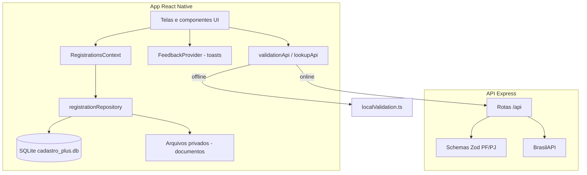

# Cadastro+ — Documentação do aplicativo

Documento para **avaliação do teste técnico (ClasseTech)** e para **referência de desenvolvimento**.

Ele combina três níveis:

| Nível | O que você encontra aqui |
|-------|---------------------------|
| **Produto** | O que o app faz, telas, fluxos do usuário (seções 1, 4, 5) |
| **Técnico** | Stack, arquitetura, pastas, API, banco, validações, testes (seções 2, 3, 6–11, 13) |
| **Avaliação** | Roteiro para testar o APK, checklist de requisitos e onde validar no código (seção abaixo) |

Quem corrige o teste pode **só ler este arquivo + instalar o APK**; quem revisa código usa as referências de pastas e arquivos citadas.

---

## 0. Guia para avaliadores (teste de avaliação)

### 0.1 Objetivo entregue

Aplicativo **Cadastro+** (Android) + **API REST** para validação e consultas (CEP/CNPJ), conforme escopo típico de teste mobile ClasseTech: cadastro PF/PJ, documentos locais, validações e persistência offline.

### 0.2 Como avaliar rapidamente (≈ 15 minutos)

1. **Instalar** o APK release (ou `npm run android` em debug).
2. **Splash** → abas: Início, Cadastros, +, Relatórios, Config.
3. **Novo cadastro PF** — botão central **+** → Pessoa Física → preencher 3 etapas → anexar PDF/JPG nos obrigatórios → salvar → toast de sucesso.
4. **Novo cadastro PJ** — consultar CNPJ (com API online) → classificar matriz/filial → representante com cargo no seletor → documentos → salvar.
5. **Cadastros** — busca, **Filtros avançados**, abrir detalhe (abas Dados / Documentos / Histórico).
6. **Importação em massa** — baixar modelo CSV, preencher uma linha válida, importar; linha inválida deve ser rejeitada com resumo.
7. **Offline** — desligar rede e tentar salvar PF: validação local (`localValidation.ts`) deve impedir dados inválidos.
8. **Config** — limpar cadastros (confirmação modal) e conferir lista vazia.
9. **Testes automatizados** (opcional): `npm test` e `cd backend && npm test`.

### 0.3 Checklist de requisitos × evidência

| Requisito esperado | Onde ver no app | Onde ver no código |
|--------------------|-----------------|---------------------|
| Cadastro PF com validação | Formulário 3 etapas | `src/screens/PersonForm/`, `backend/src/schemas/person.ts` |
| Cadastro PJ + CNPJ | Formulário + botão consulta | `CompanyFormScreen`, `lookupApi`, `brasilApi.ts` |
| CEP automático | Etapa endereço “Buscar” | `useCepLookup`, `GET /lookups/cep` |
| Documentos anexos | Etapa 3 | `DocumentPickerField`, `services/storage/documents.ts` |
| Persistência local | Dados após fechar app | `services/database/`, `registrationRepository.ts` |
| Listagem e filtros | Aba Cadastros | `RegistrationsScreen`, `RegistrationFiltersPanel` |
| Unicidade CPF/CNPJ | Tentar duplicar documento | `validationApi` + `unique-document` |
| API de validação | Com internet | `backend/`, URL em `src/config/api.ts` |
| Funciona sem API (validação) | Modo avião ao avançar etapa | `localValidation.ts`, fallback em `validationApi.ts` |
| UX / feedback | Toasts e modal | `FeedbackProvider`, `utils/alerts.ts` |
| Testes | CI local | `__tests__/`, `backend/src/utils/cpf.test.ts` |

### 0.4 API em produção (avaliador remoto)

- URL configurada no app release: `PRODUCTION_API_URL` em `src/config/api.ts` (Render).
- Health check: `GET .../health`.
- Sem backend local, consultas CEP/CNPJ e validação online dependem dessa URL; cadastros e validação **offline** continuam parcialmente funcionais via regras locais.

### 0.5 Decisões técnicas relevantes para a nota

- **Offline-first**: SQLite é a fonte da verdade; API não armazena cadastros do usuário.
- **Validação espelhada**: Zod (servidor) + TypeScript (cliente) reduz divergência e permite demo sem rede.
- **Separação de camadas**: telas → context → repository → SQLite (facilita teste e manutenção).
- **Escopo extra** (além do mínimo): importação CSV em massa, relatórios, filtros avançados inline, UI customizada e toasts.

### 0.6 Limitações conscientes (transparência na avaliação)

- Sem autenticação / multi-usuário / sync em nuvem.
- Importação em massa não anexa documentos (cadastro fica **pendente** até edição manual).
- Planilha em **CSV** (Excel abre nativamente; não há `.xlsx` nativo no app).

---

## 1. Visão geral

O **Cadastro+** é um aplicativo mobile (React Native) para **gestão de cadastros de Pessoa Física (PF) e Pessoa Jurídica (PJ)** no aparelho. O usuário pode:

- Criar e editar cadastros em formulários guiados por etapas
- Anexar documentos (PDF/imagem) com limite de tamanho
- Consultar CEP e CNPJ via API backend
- Validar CPF/CNPJ e regras de negócio (API com fallback local offline)
- Listar, filtrar e ver detalhes de cada cadastro
- Importar vários cadastros de uma vez via **planilha CSV**
- Ver **relatórios** resumidos (percentual de documentação completa, PF/PJ, pendências)

Não há login nem sincronização em nuvem dos cadastros: **dados e arquivos ficam locais** (SQLite + armazenamento privado do app).

---

## 2. Stack tecnológica

| Camada | Tecnologia |
|--------|------------|
| Mobile | React Native 0.88, React 19, TypeScript |
| Navegação | React Navigation (Native Stack + Bottom Tabs) |
| Formulários | React Hook Form |
| Banco local | react-native-nitro-sqlite |
| Arquivos | @dr.pogodin/react-native-fs, @react-native-documents/picker |
| Ícones | react-native-vector-icons (Material Community Icons) |
| HTTP | Axios |
| API | Node.js, Express, Zod |
| Consultas externas | BrasilAPI (CEP/CNPJ), via backend |

---

## 3. Arquitetura



### Camadas no código (`src/`)

1. **Screens** — telas (Dashboard, Cadastros, formulários, detalhes, etc.)
2. **Components** — UI reutilizável (Button, FormField, SelectField, filtros, importação em massa)
3. **Context** — `RegistrationsContext` carrega lista, estatísticas e operações save/remove/clear
4. **Repositories** — acesso ao SQLite (`registrationRepository`, `profileRepository`)
5. **Services** — API HTTP, validação local, bulk import CSV, persistência de documentos
6. **Theme** — cores, tipografia, espaçamentos, hook `useLayout` (responsivo/tablet)
7. **Constants** — catálogos (sexo, cargo, matriz/filial) em `catalog.ts`
8. **Utils** — máscaras CPF/CNPJ/CEP, CPF/CNPJ validators, alertas (`alerts.ts` → toasts)

---

## 4. Navegação

### 4.1 Fluxo inicial

1. **Splash** — logo e tagline; redireciona para as abas principais
2. **MainTabs** — navegação inferior fixa

### 4.2 Abas inferiores (5 itens)

| Aba | Tela | Função |
|-----|------|--------|
| Início | `DashboardScreen` | Métricas, atalho “+ Novo cadastro”, últimos cadastros |
| Cadastros | `RegistrationsScreen` | Lista, busca, filtros avançados, importação em massa |
| **+** (centro) | — | Abre fluxo **Tipo de cadastro** (PF ou PJ) |
| Relatórios | `ReportsScreen` | Taxa de documentação completa, totais PF/PJ/pendências |
| Config | `SettingsScreen` | Configurações **somente de cadastros** (validação, limpar dados) |

### 4.3 Pilha (stack) sobre as abas

| Rota | Tela |
|------|------|
| `SelectPersonType` | Escolha PF ou PJ |
| `PersonForm` | Cadastro/edição PF (3 etapas) |
| `CompanyForm` | Cadastro/edição PJ (3 etapas) |
| `RegistrationDetails` | Detalhes com abas Dados / Documentos / Histórico |

A tela dedicada **Filtros** foi removida: filtros ficam **inline** em Cadastros (“Filtros avançados”).

---

## 5. Funcionalidades por módulo

### 5.1 Dashboard (Início)

- Cards: total de cadastros, PF, PJ, pendências de documentação
- Botão **+ Novo cadastro**
- Lista dos **últimos cadastros** com indicador visual de status (completo / pendente)

### 5.2 Cadastros

- **Busca** por nome, CPF ou CNPJ
- **Filtros avançados** (painel expansível):
  - Tipo: Todos, PF, PJ
  - Documentação: Todos, Completa, Pendente, Com pendência
  - Classificação PJ: Matriz, Filial, Unidade, etc.
- Contador de resultados filtrados
- **Cadastro em massa** (`BulkImportPanel`):
  - Aba **CPF (PF)** ou **CNPJ (PJ)**
  - **Baixar modelo** CSV (compartilhar/salvar)
  - **Importar planilha** — validação linha a linha; só linhas válidas são salvas
- Toque em item → **Detalhes**

### 5.3 Formulário Pessoa Física

Etapas (`StepIndicator`):

1. **Dados** — nome, CPF, nascimento, **sexo** (select), e-mail, telefone  
2. **Endereço** — CEP com busca automática, logradouro, número, complemento, bairro, cidade, UF  
3. **Documentos** — identificação e comprovante de residência (obrigatórios), complementar (opcional)

Validação ao avançar: API; se rede indisponível, **validação local** espelhando regras do backend. Unicidade de CPF checada antes de seguir.

### 5.4 Formulário Pessoa Jurídica

Etapas:

1. **Empresa** — CNPJ (consulta automática), razão social, fantasia, **classificação** (matriz/filial/unidade…), CNPJ da matriz se filial, e-mail, telefone, endereço completo  
2. **Representante legal** — nome, CPF, **cargo** (select do catálogo), e-mail, telefone  
3. **Documentos** — cartão CNPJ, contrato social, documento do representante, comprovante de endereço

### 5.5 Detalhes do cadastro

Abas:

- **Dados** — informações gerais, endereço, representante (PJ); botões **Editar** abrem o formulário no passo correto  
- **Documentos** — lista de anexos com abertura do arquivo  
- **Histórico** — linha do tempo (criação, atualização, anexos)

Ações: editar cadastro, excluir (com confirmação modal).

### 5.6 Relatórios

- Percentual de cadastros com documentação completa  
- Totais PF, PJ e pendências  
- Atalhos para lista filtrada ou lista completa  

### 5.7 Configurações

Foco em cadastros:

- Texto sobre validação automática e duplicidade  
- Orientação sobre importação em massa (feita na aba Cadastros)  
- Resumo local (contagens) e **limpar todos os cadastros**

---

## 6. Modelo de dados

### 6.1 Registro (`Registration`)

Armazenado como JSON na coluna `payload` da tabela `registrations`, com índices para busca:

- `id`, `type` (PF | PJ)
- `person` ou `company` (dados do formulário)
- `documents[]` — metadados + URI local do arquivo
- `documentationStatus` — `complete` | `pending` | `issue`
- `createdAt`, `updatedAt`

**PF** inclui campo `sexo` (catálogo).  
**PJ** inclui `tipoEstabelecimento`, `cnpjMatriz` (quando filial) e representante com `cargo` (valor do catálogo).

### 6.2 SQLite (`src/services/database/index.ts`)

Tabelas principais:

- `registrations` — cadastros
- `user_profile` — perfil local (legado/opcional; UI de perfil foi simplificada nas configurações atuais)

### 6.3 Documentos

Arquivos copiados para diretório privado do app (`services/storage/documents.ts`). Remoção junto com o cadastro.

---

## 7. Validações

### 7.1 API (backend)

Schemas Zod em `backend/src/schemas/`:

- **PF** — etapas 1 (dados + sexo), 2 (endereço), 3 (vazia no schema; documentos validados no app)
- **PJ** — etapa 1 com endereço e classificação de estabelecimento; regras extras para **filial + CNPJ matriz**
- **Representante** — etapa 2
- **Unicidade** — endpoint `unique-document`

### 7.2 App

`src/services/api/validationApi.ts`:

- Tenta POST na API
- Se falha de **rede**, usa `localValidation.ts` (mesmas regras principais)
- Perfil (se usado): `profileValidation.ts`

Erros de API são mapeados para campos do formulário via `applyApiErrors` (React Hook Form).

---

## 8. Importação em massa (CSV)

Arquivos em `src/services/bulkImport/`:

| Arquivo | Responsabilidade |
|---------|------------------|
| `csvTemplates.ts` | Cabeçalhos, exemplo de linha, parser CSV (vírgula ou `;`) |
| `bulkImportService.ts` | Valida cada linha, detecta duplicados na planilha e no banco |
| `shareTemplate.ts` | Grava modelo e abre compartilhamento |

**PF:** `nome_completo, cpf, data_nascimento, sexo, email, telefone`  
**PJ:** `cnpj, razao_social, nome_fantasia, tipo_estabelecimento, cnpj_matriz, email, telefone, representante_*`

Valores de catálogo devem seguir `src/constants/catalog.ts` (ex.: `feminino`, `matriz`, `socio_administrador`).

Cadastros importados entram **sem documentos** → status **pendente** até completar anexos na edição manual.

---

## 9. Interface e experiência

### 9.1 Design system (`src/theme/`)

- Cor primária azul (#0055FF), fundos claros, cards com borda/sombra leve
- Botões em formato **pill**
- Campos com fundo cinza e borda azul no foco
- Ícones vetoriais (`AppIcon`)

### 9.2 Responsividade

- Hook `useLayout`: padding, largura máxima em tablet, grid de métricas 2 ou 4 colunas
- `FormRow` — dois campos lado a lado em tablet
- `Screen` — `KeyboardAvoidingView` + `automaticallyAdjustKeyboardInsets` para o teclado não cobrir inputs

### 9.3 Feedback ao usuário

`FeedbackProvider` + `utils/alerts.ts`:

- **Toasts** no topo (sucesso, erro, atenção, informação)
- **Modal de confirmação** para ações destrutivas
- Substitui `Alert.alert` nativo na maior parte do app

### 9.4 Componentes notáveis

- `SelectField` — menu inferior para sexo, cargo, matriz/filial
- `PillTabs` / `SegmentedTabs` — filtros e abas
- `StepIndicator` — progresso nos formulários
- `RegistrationFiltersPanel` — filtros na lista

---

## 10. API backend

Pasta `backend/`. Em produção o app aponta para `PRODUCTION_API_URL` em `src/config/api.ts`. Em desenvolvimento, usa `api.local.json` (exemplo em `api.local.example.json`) ou host do Metro.

| Método | Rota | Descrição |
|--------|------|-----------|
| GET | `/api/health` | Saúde da API |
| POST | `/api/validations/person/step/:step` | Valida etapa PF |
| POST | `/api/validations/company/step/:step` | Valida etapa PJ |
| POST | `/api/validations/unique-document` | CPF/CNPJ duplicado |
| GET | `/api/lookups/cep/:cep` | CEP |
| GET | `/api/lookups/cnpj/:cnpj` | CNPJ |

Deploy referenciado no README (Render).

---

## 11. Como o projeto foi organizado (decisões)

1. **Offline-first nos cadastros** — SQLite como fonte da verdade; API só valida/consulta quando há rede.
2. **Formulários em etapas** — reduz carga cognitiva e espelha fluxo do design (dados → endereço → documentos).
3. **Catálogos centralizados** — sexo, cargo e tipo de estabelecimento em um único arquivo para UI e validação consistentes.
4. **Validação dupla** — Zod no servidor + TypeScript local evita cadastro inválido mesmo offline.
5. **Importação CSV** — escolha simples (sem dependência pesada de XLSX); Excel abre CSV nativamente.
6. **UI customizada** — tema único do produto, tabs e detalhes alinhados a app de gestão de cadastros, não template genérico.
7. **Testes** — Jest para CPF/CNPJ, repositório, perfil, bulk import e smoke do `App`.

---

## 12. Execução e build

### Desenvolvimento

```bash
# Terminal 1 — API
cd backend && npm install && npm run dev

# Terminal 2 — Metro
npm install && npm start

# Terminal 3 — Android
npm run android
```

Opcional: `npm run api:host` e `src/config/api.local.json` para IP da máquina na rede.

### Testes

```bash
npm test
cd backend && npm test
```

### APK release

```bash
npm run apk
# ou: cd android && ./gradlew assembleRelease
```

Ícones Android: recursos em `android/app/src/main/res/`; fontes dos ícones via `react-native.config.js` e `fonts.gradle`.

---

## 13. Estrutura de pastas (resumo)

```text
CadastroPlus/
├── App.tsx                 # Providers: SafeArea, Registrations, Feedback
├── docs/
│   └── DOCUMENTACAO.md     # Este arquivo
├── backend/                # API Express
├── android/ / ios/         # Projetos nativos
└── src/
    ├── components/         # UI + BulkImport + Filters + feedback
    ├── constants/          # catalog.ts
    ├── context/            # RegistrationsContext
    ├── hooks/              # CEP, CNPJ, useLayout
    ├── navigation/         # RootNavigator, MainTabs
    ├── repositories/       # SQLite
    ├── screens/            # Telas
    ├── services/           # API, bulk import, validation, storage
    ├── theme/
    ├── types/
    └── utils/
```

---

## 14. Evolução recente (referência)

- Redesign visual alinhado ao mock Cadastro+
- Perfil simplificado; dashboard sem notificações
- Aba Documentos substituída por **Relatórios**
- Configurações focadas em cadastros
- Filtros inline; toasts customizados
- Importação em massa PF/PJ via CSV

Para detalhes de commit, consulte o histórico Git (`git log`) no repositório **ClasseTech/CadastroPlus**.

---

*Documentação do projeto Cadastro+ — ClasseTech (teste técnico / avaliação). Versão do app: 1.0.0.*
